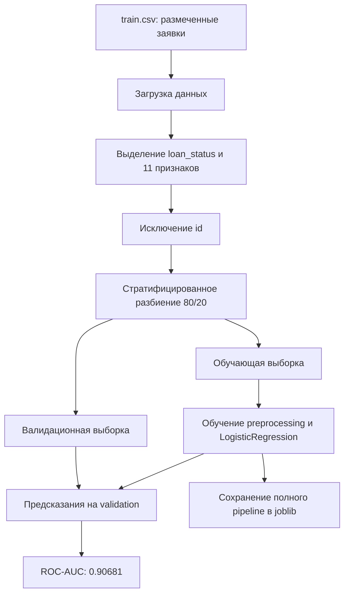
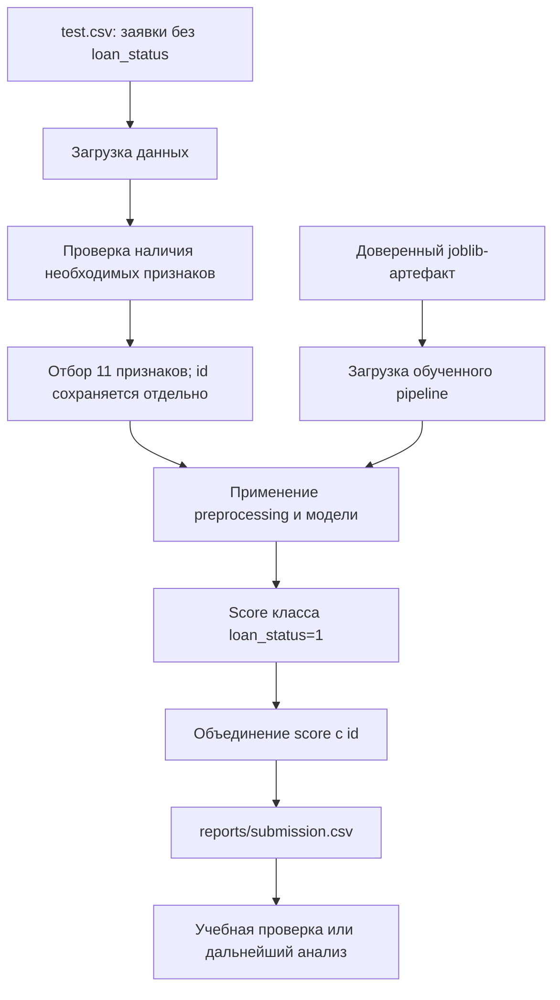
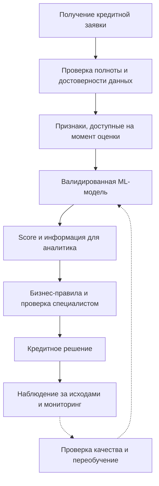

# Место ML-модели в процессе проекта

## 1. Назначение схемы

Ниже показан реализованный технический процесс учебного проекта:
подготовка модели, пакетное предсказание и формирование submission.

Диаграммы представлены в Mermaid. Это схемы процесса,
а не формальные BPMN 2.0-модели.

## 2. Обучение и оценка

Preprocessing обучается только на обучающей части.
На validation применяются уже обученные преобразования.

Текущая реализация сохраняет модель, обученную на 80% train.csv;
повторное обучение на всей выборке после оценки не выполняется.

## 3. Реализованный процесс предсказания

### Какую задачу решает модель

Модель рассчитывает score положительного класса loan_status
для заявки по её характеристикам. Она позволяет ранжировать заявки
по соответствию этому классу.

Смысл класса 1 необходимо подтвердить по документации источника.
Текущий score не является самостоятельным решением об одобрении кредита.

### Почему здесь целесообразно использовать ML

В проекте имеется размеченная выборка, связывающая характеристики
заявок с целевой меткой. ML позволяет обучить зависимость на этих
примерах и проверить способность обобщения на отложенных данных.

LogisticRegression используется как простой воспроизводимый baseline.
Преимущество перед бизнес-правилами или другими моделями отдельно
не измерялось.

### Какие данные поступают на вход

Модель использует 11 признаков:

- возраст, доход и стаж;
- форма владения жильём;
- цель и категория кредита;
- сумма, процентная ставка и отношение суммы к доходу;
- сведения о кредитной истории.

Точные имена колонок и preprocessing приведены в model_card.md.

id нужен для связывания предсказания с исходной строкой,
но не используется моделью.

### Как используется результат

В текущем проекте score и id записываются в submission.csv.
Файл используется как результат пакетного предсказания.

Реальная интеграция с банковскими системами, автоматическое кредитное
решение и обработка заявок в реальном времени не реализованы.

## 4. Возможное место в бизнес-процессе

Следующая схема описывает предполагаемую интеграцию,
а не существующую функциональность проекта.

В таком процессе модель выступает компонентом поддержки решения,
а не заменой специалиста.

Перед интеграцией необходимо подтвердить смысл целевой метки,
проверить калибровку, fairness, доступность признаков и качество
на актуальных данных. Порог и правила использования score
должны определяться отдельно с учётом стоимости ошибок.

## 5. Связь с кодом

| Этап | Реализация |
|---|---|
| Пути и параметры | src/loan_approval/config.py |
| Загрузка данных | src/loan_approval/data.py |
| Отбор признаков и preprocessing | src/loan_approval/features.py |
| Обучение и оценка | src/loan_approval/train.py |
| Предсказание и submission | src/loan_approval/predict.py |

Подробнее о модели, метриках и ограничениях: [Model Card](model_card.md).
