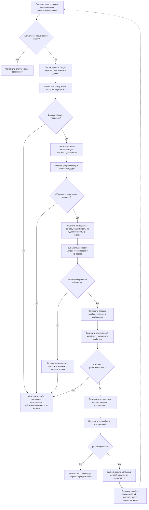

# Процесс автоматического переобучения Loan Approval Prediction

## 1. Назначение и статус

Документ описывает проектируемый процесс автоматического
переобучения модели Loan Approval Prediction: от появления
новых размеченных данных до публикации новой версии
для пакетного предсказания.

Текущий проект уже содержит:

- загрузку CSV;
- preprocessing признаков;
- обучение LogisticRegression;
- оценку ROC-AUC;
- сохранение pipeline через joblib;
- пакетное предсказание и формирование submission.csv.

Автоматический запуск, контроль публикации, версионированное
хранилище, переключение активной модели и rollback пока
не реализованы. Они описаны ниже как целевое развитие проекта.

Диаграмма выполнена в Mermaid и показывает логику процесса.
Она не является формальной BPMN 2.0-моделью.

## 2. Схема процесса



## 3. Этапы процесса и передаваемые результаты

| Этап | Что происходит | Что передаётся дальше |
|---|---|---|
| 1. Триггер | Планировщик раз в неделю проверяет наличие нового размеченного пакета | Сведения о доступном пакете либо статус отсутствия новых данных |
| 2. Фиксация запуска | Создаются run_id, снимок данных и ссылка на commit кода | Воспроизводимое описание запуска |
| 3. Валидация данных | Проверяются колонки, типы, метки, пропуски, дубликаты и достаточность данных | Проверенный набор данных либо отчёт об ошибках |
| 4. Подготовка выборок | Формируются обучающая и независимая контрольная выборки | Train, holdout и описание разбиения |
| 5. Обучение | На train обучаются preprocessing и LogisticRegression | Pipeline-кандидат |
| 6. Оценка | Кандидат и действующая модель оцениваются на одном holdout | Сопоставимые метрики обеих моделей |
| 7. Решение о публикации | Метрики и технические проверки сравниваются с условиями публикации | Решение publish/reject и его обоснование |
| 8. Сохранение версии | Артефакт, метрики и метаданные записываются в отдельный каталог | Версионированный кандидат |
| 9. Smoke test | Сохранённый артефакт загружается заново и выполняет предсказание | Подтверждение работоспособности артефакта |
| 10. Деплой | Пакетное предсказание переключается на новую версию | Новая активная модель и ссылка на предыдущую |
| 11. Контроль после деплоя | Проверяется первый пакет результатов | Подтверждение успешного деплоя либо rollback |
| 12. Мониторинг | Контролируются ошибки, изменения данных и качество при поступлении меток | Отчёты, уведомления и данные для следующих запусков |

## 4. Триггер переобучения

Основной проектируемый триггер — еженедельная проверка
наличия нового пакета размеченных заявок.

Обучение запускается только при выполнении условий:

- существует новый пакет, который ещё не использовался;
- доступна целевая колонка loan_status;
- пакет прошёл проверки данных;
- суммарных данных достаточно для обучения и независимой оценки;
- другой запуск переобучения сейчас не выполняется.

Если новых данных нет, процесс завершается без обучения.

Изменение распределений неразмеченных данных может вызвать
уведомление, но само по себе не позволяет оценить качество
по ROC-AUC и не заменяет получение целевых меток.

Источник новых данных, расписание и параметры достаточности
должны задаваться в конфигурации будущей реализации.

## 5. Получение и подготовка данных

### Источник данных

В текущем проекте используются train.csv и test.csv.

В проектируемом процессе поступают новые пакеты с теми же
входными признаками и подтверждённой меткой loan_status.

test.csv не используется как размеченная обучающая выборка:
целевые метки в нём отсутствуют.

Предсказания предыдущей модели не используются вместо
подтверждённых меток.

### Проверки

Перед обучением необходимо проверить:

- наличие 11 ожидаемых признаков и loan_status;
- допустимые значения целевой метки: 0 и 1;
- наличие обоих классов;
- отсутствие пропусков в целевой метке;
- соответствие типов ожидаемой схеме;
- отсутствие бесконечных числовых значений;
- долю пропусков в признаках;
- наличие полностью пустых обязательных признаков;
- дубликаты и пересечения между выборками;
- согласованность смысла меток и признаков между пакетами.

Допустимые доли пропусков, минимальный размер выборки
и минимальное число объектов каждого класса должны
задаваться явно в конфигурации.

При неизвестной или изменившейся семантике данных
автоматическая публикация блокируется до проверки человеком.

### Подготовка выборок

Для табличных независимых наблюдений можно использовать
стратифицированное разбиение.

Если доступны даты заявок, предпочтительно проверить
временное разделение: обучение на более ранних данных,
оценка на более поздних.

При наличии повторных заявителей требуется разделение
по идентификатору заявителя, а не только по строкам.
Колонка id текущего датасета не считается идентификатором
человека без подтверждения документацией.

Контрольная выборка:

- не участвует в обучении preprocessing и классификатора;
- не используется для подбора гиперпараметров;
- не пересекается с данными обучения кандидата;
- одинакова для оценки кандидата и действующей модели.

При недостаточном размере независимой контрольной выборки
автоматическая публикация не выполняется.

## 6. Обучение новой версии

Используется архитектура текущего baseline:

1. Числовые признаки:
   - SimpleImputer(strategy="median");
   - StandardScaler.

2. Категориальные признаки:
   - SimpleImputer(strategy="most_frequent");
   - OneHotEncoder(handle_unknown="ignore").

3. LogisticRegression:
   - class_weight="balanced";
   - max_iter=1000;
   - random_state=42.

Колонка id не используется как признак.

Обучается весь pipeline, включая preprocessing.
Преобразования действующей модели не переобучаются
на месте.

Кандидат сохраняется отдельно и не перезаписывает
действующую модель до прохождения проверок.

В данном проектируемом варианте публикуется именно
проверенный кандидат. Повторное обучение на holdout
после проверки не выполняется, иначе опубликованный
артефакт отличался бы от оценённого.

## 7. Проверка качества и решение о публикации

### Метрики

Основная метрика — ROC-AUC по score положительного класса.

Дополнительная метрика — Average Precision, полезная
для контроля качества ранжирования положительного класса
при дисбалансе данных.

Для обеих моделей метрики рассчитываются на одной
контрольной выборке.

Зафиксированный ранее ROC-AUC 0.90681 относится к исходному
разбиению train.csv. Он не используется как единственный
порог для будущих данных: результаты на разных выборках
не являются прямым сравнением версий.

### Предлагаемые условия автоматической публикации

Для учебной схемы принимаются следующие стартовые правила:

1. Все проверки данных и технического контракта пройдены.
2. ROC-AUC кандидата не ниже 0.90.
3. ROC-AUC кандидата выше ROC-AUC действующей модели
   не менее чем на 0.002.
4. Average Precision кандидата не ниже результата
   действующей модели.
5. Контрольная выборка соответствует настроенным
   требованиям по размеру и составу классов.

Значения 0.90 и 0.002 — проектные настройки учебного процесса,
а не экспериментально обоснованные бизнес-пороги.
Перед реальным применением они должны быть согласованы
и проверены на данных.

Такие правила сами по себе не доказывают статистическую
значимость улучшения. Для реальной эксплуатации потребуется
оценка неопределённости метрик и рисков.

Если действующая модель не проходит оценку или отсутствует,
автоматическое сравнение невозможно. Первичная публикация
требует отдельного решения ответственного.

### Технические проверки

- Кандидат загружается после сохранения.
- Pipeline принимает ожидаемую схему признаков.
- Порядок классов проверен: score относится к loan_status=1.
- Число предсказаний совпадает с числом входных строк.
- Все score конечны и находятся в диапазоне от 0 до 1.
- Выход содержит id и loan_status.
- Идентификаторы и порядок строк соответствуют входному пакету.
- Unit-тесты проходят.

Автоматическая публикация не означает готовность
к автономным кредитным решениям. Это публикация версии
для учебного пакетного предсказания.

## 8. Сохранение и регистрация версии

Для учебного проекта достаточно версионированного
каталога артефактов без отдельного Model Registry:

```text
models/
├── versions/
│   ├── <run_id>/
│   │   ├── pipeline.joblib
│   │   ├── metrics.json
│   │   └── metadata.json
│   └── ...
└── active_model.json
```

Для каждой версии сохраняются:

- run_id и время запуска;
- commit SHA кода;
- версия или контрольная сумма снимка данных;
- описание разбиения;
- параметры модели;
- версии зависимостей;
- метрики кандидата и действующей модели;
- результат проверок;
- причина публикации или отказа;
- контрольная сумма артефакта.

active_model.json указывает на действующую версию
и предыдущую версию для rollback.

Артефакты и служебные файлы хранятся локально либо
в выделенном хранилище и не коммитятся в Git.
В Git сохраняются код процесса и его конфигурация.

## 9. Деплой

В текущем проекте модель используется пакетно,
поэтому целевой деплой — переключение predict.py
на проверенный версионированный pipeline.

Порядок:

1. Сохранить новый артефакт в отдельный каталог.
2. Проверить контрольную сумму и загрузку.
3. Выполнить smoke test.
4. Сохранить ссылку на предыдущую активную версию.
5. Атомарно обновить указатель active_model.json.
6. Использовать новую версию для следующего пакета.

Версия модели фиксируется на весь запуск предсказания:
один пакет не должен обрабатываться разными версиями.

В текущем predict.py используется фиксированный путь
к joblib-файлу. Чтение указателя active_model.json
потребует отдельной реализации.

## 10. Действия при ошибках

| Ситуация | Действие |
|---|---|
| Нет новых размеченных данных | Завершить запуск без обучения |
| Ошибка схемы или меток | Отклонить пакет и сохранить отчёт |
| Недостаточно данных для оценки | Не публиковать кандидата |
| Ошибка обучения | Сохранить лог и уведомить ответственного |
| Кандидат не прошёл метрики | Сохранить отчёт; действующую модель оставить |
| Ошибка сохранения или загрузки | Не переключать активную версию |
| Smoke test не пройден | Заблокировать деплой |
| Ошибка первого пакета после деплоя | Остановить публикацию результатов и выполнить rollback |
| После деплоя подтверждено падение качества | Приостановить автоматическое продвижение версий и инициировать разбор |

Повторный запуск возможен после устранения причины.
Бесконечное автоматическое повторение обучения
без изменения данных или конфигурации не предусматривается.

## 11. Контроль после деплоя

Сразу после переключения проверяются:

- успешная загрузка активной версии;
- отсутствие ошибок преобразования;
- число и диапазон предсказаний;
- соответствие выходного контракта;
- идентификатор версии, использованной для пакета.

При поступлении подтверждённых меток дополнительно
рассчитываются ROC-AUC и Average Precision
на новых наблюдениях.

До поступления меток нельзя подтвердить качество
по этим метрикам. В этот период контролируются
технические ошибки и изменения входных данных.

Для каждой операции ведётся журнал с run_id,
версией модели, статусом и причиной отказа при ошибке.

## 12. Связь с текущим кодом

| Компонент | Текущая реализация | Планируемое расширение |
|---|---|---|
| Загрузка данных | data.py | Проверки новых пакетов и снимки данных |
| Preprocessing | features.py | Сохранение текущего подхода внутри pipeline |
| Обучение | train.py | Создание отдельного кандидата без перезаписи активной модели |
| Оценка | ROC-AUC на validation | Сравнение двух моделей на одном holdout |
| Артефакт | Один joblib-файл | Версионированные артефакты и метаданные |
| Предсказание | predict.py с фиксированным путём | Загрузка активной версии и фиксация её на пакет |
| Автоматизация | Не реализована | Планировщик, проверки публикации и уведомления |
| Rollback | Не реализован | Возврат указателя на предыдущую версию |

## 13. Связанные документы

- [Model Card](model_card.md)
- [Место модели в процессе](Model_BPMN.md)
